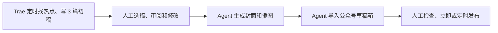

# 微信公众号发布工作流

这是我做通俗历史公众号的日常工作流，用 Trae 定时找选题、写初稿，再用两个 Skill 配图、导入公众号草稿箱。

> **AI 定时任务产出的只是初稿，每篇文章都必须由作者亲自审阅和修改。** 选哪篇、怎么讲、哪些地方有 AI 味，这些判断最考验作者的写作水平和品味。人工定稿是整套流程里最耗时、也最重要的一步。

## 怎么用

1. 在自己的飞书中新建《已写历史话题记录》，将文档链接填入 [定时任务提示词](prompts/trae-history-drafts.md)，再在 Trae 创建每日自动化任务。任务会查找最近 24 小时的热点，参考已有记录避开重复选题，写成 3 篇候选稿。
2. 从当天的候选稿或旧稿里挑一篇，在 Trae 里结合合适的写作 Skill 手工修改。确定标题和正文后，存到 `articles/` 下这篇文章自己的子目录。
3. 在 Codex、DeepSeek Harness 或 Trae Agent 里调用两个 Skill。先生成封面和正文插图，再把定稿和图片导入微信公众号草稿箱。
4. 打开公众号后台核对草稿，按需设置原创、赞赏、合集和创作来源，然后选择立即发布或定时发布。

## 两个 Skill 怎么配合

- **配图。** Agent 根据定稿写导语和生图提示词，再调用生图模型，把封面和插图下载到文章目录下。我用的是 APIMart 上的 GPT Image 2，也可以换成兼容的生图 API。 [universal-apimart-images-skill](https://github.com/JacksonYang11/universal-apimart-images-skill)
- **导入草稿。** Agent 整理 Markdown 和图片，导入工具通过微信公众号官方 API 上传图片并创建或更新草稿。正文插图按文中位置放置，封面、导语和作者写入对应字段。[wechat-draft-importer](https://github.com/JacksonYang11/WeChat-Draft-Importer-skill)

首次使用需要准备 Trae 的模型用量、生图 API 的基础地址与 API Key，以及具有相应接口权限的公众号 AppID、AppSecret 和 API IP 白名单。具体配置和后台操作见 [完整操作指南](docs/workflow.md)。

## 许可证

本项目采用 [MIT 许可证](LICENSE)。
