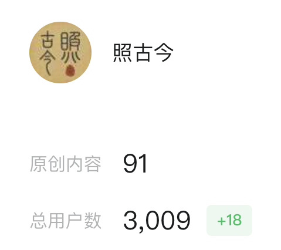

# 微信公众号发布工作流

这是我做通俗历史公众号「照古今」时整理出来的工作流。用 Trae 定时找选题、写初稿，再用两个 Skill 拟导语、配图和导入公众号草稿箱。

## 「照古今」的复更成绩

「照古今」停更了 6 年，复更时只有 100 多个关注者。重新写了约 3 个月，做到 **3,000 粉**。按专业运营的标准，这个数字很普通。我是用业余时间做这个号，每天最多发一篇，内容就是文章加几张配图，制作成本也低。

这次查后台时有 **3,009 位关注者、91 篇仍保留的已发表文章**。按单篇累计阅读，**15 篇过万**，其中 **2 篇超过 10 万**，另有 **2 篇在 5 万到 10 万之间**。阅读最高的一篇是 **209,804**。 [阅读《一千年前的“神仙单位”》](https://mp.weixin.qq.com/s/ztZlJjNXwYQ6tWD5PCoHCA)

## 能省哪些工夫

过去从找素材、搭结构、写稿到配图进草稿箱，一篇可能花好几个小时。现在定时任务提前跑完找题和写初稿，**我从选稿到进草稿箱通常能压到 1 小时以内，改得顺时能在 20 分钟以内**。

- **找素材、写初稿。** Trae 每天搜集最近 24 小时的热点，再去找能呼应的历史素材。这一步比单纯找个故事费工夫。定时任务还会搭好结构，写成 3 篇候选稿，打开就能选。
- **拟导语、配图。** 用我做的 `universal-apimart-images-skill` 读定稿，根据段落和上下文安排画面，写好生图提示词。确认后由 Skill 调用接口，批量生成并下载封面和插图，省去网上找图、逐张查转载授权的时间。按我用的 APIMart 渠道和配置，顺利时约 5 分钟出一组图，一张平均可以低到几分钱。
- **导入草稿。** 用我做的 `wechat-draft-importer` 把正文、导语、封面和插图按位置放进公众号草稿箱。作者到后台检查效果，按需设置原创、赞赏和合集，再发布。

**AI 交付的是初稿。** 人工选稿、核对史实、重写不合理或 AI 味重的段落，依然是整套流程最耗时的一步。做历史号最考验阅读积累、对历史和人物选择的理解，以及对文章的审美。什么题值得写、哪处史料有疑问、哪个开头能把读者带进去，都要作者自己拿主意。

## 怎么用

1. 在自己的飞书中新建《已写历史话题记录》，在定时任务提示词中填入文档链接、自己的公众号名称和输出目录，再在 Trae 创建每日自动化任务。每次运行都会查找最近 24 小时内的热点，参考已有记录避开重复选题，写成 3 篇候选稿。 [定时任务提示词](prompts/trae-history-drafts.md)
2. 从当天的候选稿或旧稿里挑一篇，在 Trae 里结合合适的写作 Skill 手工修改。确定标题和正文后，存到 `articles/` 下这篇文章自己的子目录。
3. 在 Codex、DeepSeek Harness 或 Trae 中，先调用配图 Skill，再调用草稿导入 Skill。
4. 打开公众号后台核对草稿，按需设置原创、赞赏、合集和创作来源，然后选择立即发布或定时发布。

首次使用需要准备 Trae 的模型用量、生图 API 的基础地址与 API Key，以及具有相应接口权限的公众号 AppID、AppSecret 和 API IP 白名单。具体配置和后台操作见 [完整操作指南](docs/workflow.md)。

## 关注和联系

**欢迎大家关注我的公众号「照古今」。** 微信里搜索「照古今」即可。

有使用体会或想聊聊工作流，欢迎给我发邮件。 [964372370@qq.com](mailto:964372370@qq.com)

## 许可证

本项目采用 [MIT 许可证](LICENSE)。

## 用到的开源 Skill 和工具

下面三个 Skill 由我制作并开源。

- `bohaixiaoli-perspective`（v4.1）用于通俗历史写作。 [GitHub](https://github.com/JacksonYang11/bohaixiaoli-skill)
- `universal-apimart-images-skill` 用于拟导语、规划配图和批量生图。支持兼容的生图 API。 [GitHub](https://github.com/JacksonYang11/universal-apimart-images-skill)
- `wechat-draft-importer` 用于把定稿和配图导入公众号草稿箱。 [GitHub](https://github.com/JacksonYang11/WeChat-Draft-Importer-skill)

工作流还用到以下开源工具。

- `qu-ai-wei` 用于润色初稿、减少 AI 写作痕迹。 [GitHub](https://github.com/LifelongLazyLearner/qu-ai-wei)
- `lark-cli`（含 `lark-doc`）用于读取和更新飞书选题记录。 [GitHub](https://github.com/larksuite/cli)

定时任务还用到 Trae 自带的微信公众号文章插件 `trae-remote-official:wechat-mp-article`。我用 APIMart 的 GPT Image 2 生图，草稿导入走微信官方接口。 [Trae](https://www.trae.cn/) · [APIMart](https://apimart.ai/zh/model/gpt-image-2) · [微信开发者平台](https://developers.weixin.qq.com/platform/)
